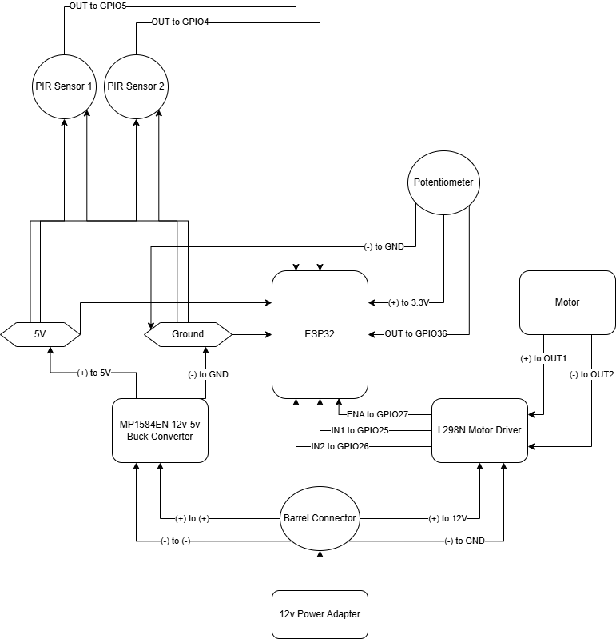

# TSE Scrolling Mechanism
Code and schematics for the scrolling mechanism used in VOICE's Time Space Existence exhibition.

## Hardware Components

| Component | Description | Datasheet | Link |
|-----------|------------|------| ------ |
| **ESP32** | Microcontroller for handling inputs and motor control | [ESP32-DevKitC](https://docs.espressif.com/projects/esp-dev-kits/en/latest/esp32/esp32-devkitc/user_guide.html#related-documents), [Nodemcu-32s](https://mischianti.org/esp32-nodemcu-32s-esp-32s-kit-high-resolution-pinout-datasheet-and-specs) | [Buy](https://www.amazon.com/Teyleten-Robot-ESP-WROOM-32-Development-Microcontroller/dp/B09J95SMG7) |
| **HC-SR501 PIR Sensors** | Detects motion to trigger scrolling | [HC-SR501](https://www.handsontec.com/dataspecs/SR501%20Motion%20Sensor.pdf) | [Buy](https://www.amazon.com/HiLetgo-HC-SR501-Infrared-Sensor-Arduino/dp/B07KZW86YR) |
| **Worm Gear Motor** | Drives the scrolling mechanism | - | [Buy](https://www.amazon.com/gp/aw/d/B0774HGZGX) |
| **L298N Motor Driver** | Controls motor and protects circuit from excessive current | [L298N](https://www.handsontec.com/dataspecs/L298N%20Motor%20Driver.pdf) | [Buy](https://www.amazon.com/Controller-H-Bridge-Stepper-Control-Mega2560/dp/B07WS89781) |
| **MP1584EN 12V to 5V Buck Converter** | Steps down 12V to 5V power supply for ESP32 and other low-voltage components | - | - |
| **Potentiometer** | Adjusts motor speed | - | - |
| **12V Female 2.1x5.5MM DC Barrel Jack Plug Adapter** | Connects the power supply to the circuit | - | [Buy](https://www.amazon.com/dp/B01J1WZENK) |
| **Power Supply Adapter (12V)** | Supplies power to motor and circuit | - | - |
| **Jumper Wires** | Connects components | - | [Buy](https://www.amazon.com/dp/B09FNZ6QFQ) |
| **Breadboard** | Used for prototyping the circuit | - | [Buy](https://www.amazon.com/Breadboards-Solderless-Breadboard-Distribution-Connecting/dp/B07DL13RZH) |

## Wiring Diagram

## How it works
- The PIR sensors detect motion and sends a HIGH pulse to the ESP32.
  - The ESP32 sends signals to the L298N motor driver to rotate the worm gear motor.
  - The motor will run for 2 minutes. If continuous motion occurs, the 2-minute timer will keep resetting with each new detection. If no movement is detected within the 2 minutes, the motor will turn off.
- The speed can be adjusted via the potentiometer.
> NOTE: This will work with the Single Trigger Mode (L) on the PIR sensors with the lowest time delay. We ran into issues with the Repeatable Trigger Mode (H) so we went with the Single Trigger Mode.